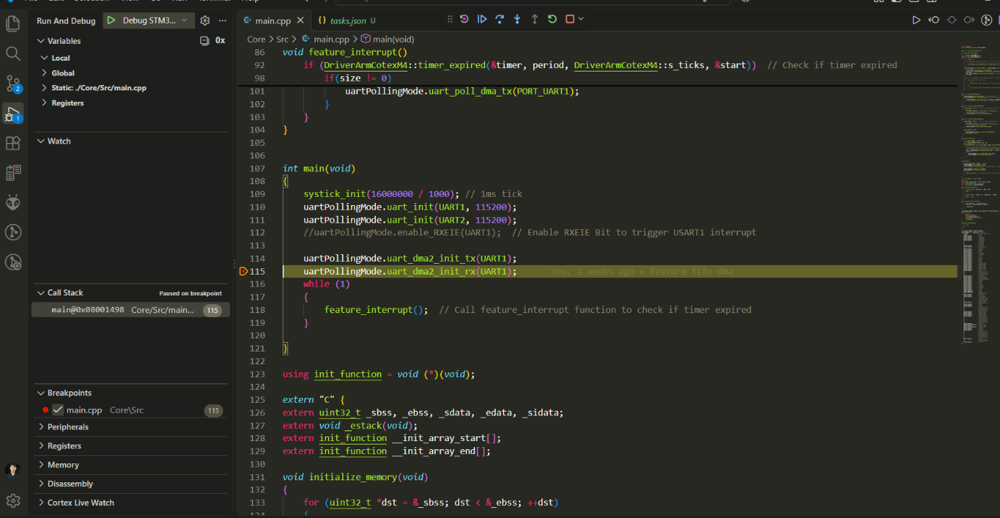

A project built from the ground up: developing custom libraries, writing peripheral drivers, and applying advanced programming techniques—such as the embedded structure patterns found in the Linux kernel.

Object-oriented programming implemented in C++.

The APIs have been verified on actual hardware; this repository is currently built for the STM32F401RET6 microcontroller.
Implementation of advanced communication techniques, including DMA and interrupts.

## Project chapters

This project uses a bare-metal, register-level design for the STM32F401RE. Peripheral registers are represented by C++ structs mapped to their memory addresses; the drivers configure those registers directly without HAL or Cube-generated startup code.

### Chapter 1 - Register-level foundation

[`Core/Inc/define.h`](Core/Inc/define.h) defines fixed-width types, peripheral base addresses, register layouts, bit/pin helpers, and UART/DMA/NVIC identifiers. The driver accesses RCC, GPIO, USART, DMA, SysTick, and NVIC registers through `volatile` pointers so reads and writes reach the hardware.

The project targets a 16 MHz core clock (`FREQ`). The linker memory map and bare-metal reset/startup flow are described in Chapter 9.

**Try it:** inspect USART1's status register through the register map:

```cpp
uint32_t status = UART1->SR;
if (status & BIT(5)) {
    // RXNE: a received byte is ready in the data register.
}
```

`BIT(n)` creates a mask for bit `n`; `UART1` is the mapped USART1 register block. Prefer the driver APIs in application code unless a chapter is specifically demonstrating direct register access.

### Chapter 2 - SysTick time base

[`systick_init()`](Core/Src/Uart.cpp) configures SysTick to generate an interrupt every 1 ms when called with `16000000 / 1000`. [`SysTick_Handler()`](Core/Src/main.cpp) increments the shared `s_ticks` counter. The `timer_expired()` helper uses that tick count to schedule work; the current application checks for received UART data every 500 ms.

**Try it:** initialize the 1 ms tick once, then poll a 500 ms timer from the main loop:

```cpp
systick_init(FREQ / 1000);

// In the main loop:
static uint32_t timer = 0;
static uint32_t start = 0;
if (DriverArmCotexM4::timer_expired(
        &timer, 500, DriverArmCotexM4::s_ticks, &start)) {
    // Run a periodic application task.
}
```

Do not call `systick_init()` repeatedly inside the loop. `timer_expired()` is also used by the current application in `feature_interrupt()` in [`Core/Src/main.cpp`](Core/Src/main.cpp).

### Chapter 3 - GPIO and alternate functions

The `GPIO` helpers in [`Core/Inc/Uart.h`](Core/Inc/Uart.h) set a pin's mode, select an alternate-function number, and write its output using the GPIO `BSRR` register. UART setup selects the MCU pins and alternate functions required to connect them to each USART:

| USART | TX pin | RX pin | Alternate function |
|---|---|---|---|
| USART1 | PA9 | PA10 | AF7 |
| USART2 | PA2 | PA3 | AF7 |
| USART6 | PA11 | PA12 | AF8 |

**Try it:** configure PA5 as a GPIO output and set it high or low:

```cpp
uint16_t led = PIN('A', 5);
DriverArmCotexM4::GPIO::gpio_set_mode(
    led, DriverArmCotexM4::OUTPUT);
DriverArmCotexM4::GPIO::gpio_write(led, true);  // Set high
DriverArmCotexM4::GPIO::gpio_write(led, false); // Set low
```

Choose a pin that is available on your board and is not being used by another peripheral.

### Chapter 4 - UART operation and polling helpers

[`DriverUART::uart_init()`](Core/Src/Uart.cpp) enables the selected USART clock, configures its TX/RX pins, calculates the baud-rate register value from the 16 MHz clock, and enables the USART, transmitter, and receiver. The application initializes USART1 and USART2 at 115200 baud.

The driver provides register-level status and byte helpers for checking RX-ready, TX-ready, transmission-complete, and UART IDLE conditions. `uart_write_byte_for_polling()` and `uart_write_buf()` provide blocking transmit helpers. These are driver APIs; the current application's main data path uses DMA rather than polling each byte.

**Try it:** send a short string using blocking, byte-at-a-time polling:

```cpp
DriverArmCotexM4::DriverUART uart;
uart.uart_init(UART1, 115200);
char text[] = "Hello UART\r\n";
uart.uart_write_buf(UART1, text, sizeof(text) - 1);
```

`uart_write_buf()` waits for each byte's transmission to complete, so it is simple to test but blocks the caller. Do not initialize another `DriverUART` instance for the DMA application unless that instance also owns the DMA/FIFO setup.

### Chapter 5 - UART and NVIC interrupts

The driver contains helpers to enable/disable USART RXNE and TXE interrupts and to enable USART IRQs in the NVIC. The vector table in [`Core/Src/main.cpp`](Core/Src/main.cpp) maps USART1 and USART2 to their handlers.

In the current application, USART1's IDLE interrupt marks the end of a received burst and passes the newly received DMA data to the RX FIFO. A USART2 TXE handler is also present, but its byte source (`receivedByteDMA`) is not populated by the active application path. The earlier byte-at-a-time interrupt forwarding code is commented out, so this is not currently an active USART1-to-USART2 transfer.

**Try it (RXNE without DMA):** initialize USART1, enable its RXNE interrupt, and read the byte in the handler:

```cpp
// Initialization:
uartPollingMode.uart_init(UART1, 115200);
uartPollingMode.enable_RXEIE(UART1);

// In USART1_IRQHandler():
if (uartPollingMode.uart_read_ready(UART1)) {
    uint8_t byte = uartPollingMode.uart_read_byte(UART1);
    // Store byte or signal the main loop; keep ISR work short.
}
```

This is an alternative receive mode, not an extra step for the active DMA receiver. Do not enable RXNE byte handling alongside DMA reception unless the two paths are intentionally coordinated.

### Chapter 6 - DMA reception and transmission

The active DMA path uses USART1 with DMA2:

- **RX: DMA2 Stream 5.** Double-buffer mode alternates between two 128-byte memory buffers. At half-transfer (64 bytes), the ISR copies new data from the active buffer into the 1024-byte RX FIFO. At transfer-complete, it copies the remainder from the completed buffer while DMA has moved to the other buffer. USART IDLE copies any additional bytes from the active buffer when a burst pauses before HT or TC.
- **TX: DMA2 Stream 7.** Application data is queued in a 1024-byte TX FIFO. The driver copies up to 128 bytes at a time into a DMA TX buffer and starts a memory-to-peripheral transfer to USART1. The transfer-complete ISR starts the next queued chunk.

The DMA buffer sizes and FIFO sizes are defined in [`Core/Inc/Uart.h`](Core/Inc/Uart.h); configuration, ISR callbacks, and queue handling are implemented in [`Core/Src/Uart.cpp`](Core/Src/Uart.cpp).

**Try it:** the initialization used by the active application is:

```cpp
uartPollingMode.uart_init(UART1, 115200);
uartPollingMode.uart_dma2_init_tx(UART1);
uartPollingMode.uart_dma2_init_rx(UART1);
```

Then queue outgoing bytes and start the TX FIFO pump:

```cpp
uint16_t queued = uartPollingMode.uart_write(
    PORT_UART1, data, data_size);
if (queued != 0) {
    uartPollingMode.uart_poll_dma_tx(PORT_UART1);
}
```

For receive, the DMA/USART handlers feed the internal RX FIFO; application code retrieves bytes with `uart_read(PORT_UART1, buffer, sizeof(buffer))`. The vector table must point to `DMA2_Stream5_IRQHandler`, `DMA2_Stream7_IRQHandler`, and `USART1_IRQHandler`; the current project already does this. Do not call the ISR callbacks directly from application code.

### Chapter 7 - Application data flow and two USARTs

The current `main()` initializes USART1 and USART2 at 115200 baud, configures DMA RX/TX for USART1, and then repeatedly checks the RX FIFO. Every 500 ms, if data is available, the application queues the same bytes for USART1 transmission and starts DMA TX. In other words, the active demo is a **USART1 DMA echo**.

USART2 initialization and its interrupt handler demonstrate additional driver support, but the current application does not route received USART1 bytes to USART2 or receive bytes on USART2. A two-USART forwarding example would need to connect the USART1 RX data path to USART2's TX path and configure the required USART2 transmit mechanism; that end-to-end behavior is not implemented in the current `main()`.

The echo application is implemented in `feature_interrupt()` in [`Core/Src/main.cpp`](Core/Src/main.cpp): it reads up to 1024 bytes from RX FIFO every 500 ms, queues them in TX FIFO, and starts DMA TX. TX chunks are sent consecutively by the DMA transfer-complete handler; the next chunk does not wait for another 500 ms poll.

**Try it on hardware:** connect a 3.3 V USB-UART adapter's TX to PA10, RX to PA9, and GND to board GND. Open a serial terminal at **115200, 8-N-1**, disable local echo, and set line ending to **None**. Send a payload of 129 characters, for example:

```text
0123456789ABCDEFGHIJKLMNOPQRSTUVWXYZabcdefghijklmnopqrstuvwxyz!?0123456789ABCDEFGHIJKLMNOPQRSTUVWXYZabcdefghijklmnopqrstuvwxyz!?@
```

The expected echo is the same 129 characters, in order. Sending a continuous stream longer than the 1024-byte RX FIFO without allowing the application to drain it can overflow the FIFO; begin with short bursts and verify each echo.

**Try a USART1-to-USART2 polling bridge (alternative application):** instead of using DMA RX, poll USART1 for bytes and send each byte through USART2:

```cpp
uartPollingMode.uart_init(UART1, 115200);
uartPollingMode.uart_init(UART2, 115200);

while (1) {
    if (uartPollingMode.uart_read_ready(UART1)) {
        uint8_t byte = uartPollingMode.uart_read_byte(UART1);
        uartPollingMode.uart_write_byte_for_polling(UART2, byte);
    }
}
```

This example is mutually exclusive with the active DMA receive setup on USART1. Connect the host to USART1 RX and connect USART2 TX (PA2) to the receiving device's RX, with grounds shared.

### Chapter 8 - FIFO buffering and interrupt safety

[`FIFO`](Core/Inc/fifo.h) and [`Core/Src/fifo.cpp`](Core/Src/fifo.cpp) implement a fixed-size circular buffer with read/write pointers, occupied/free-size tracking, and optional lock/unlock callbacks. UART DMA callbacks use the FIFOs to decouple data arrival/transmission from application processing. The UART driver supplies critical-section callbacks that disable and re-enable CPU interrupts while updating FIFO data.

The low-level `_fifo_t` type is private to `FIFO` and exposed to `DriverUART` as a friend; application code normally uses the driver's UART FIFO APIs rather than creating a FIFO directly.

**Try it with the UART RX FIFO:** periodically drain whatever data is available:

```cpp
uint8_t data[64];
uint16_t count = uartPollingMode.uart_read(
    PORT_UART1, data, sizeof(data));
if (count != 0) {
    // Process data[0] through data[count - 1].
}
```

**Try it with the UART TX FIFO:** queue bytes and ask the DMA driver to transmit queued data:

```cpp
const uint8_t reply[] = {'O', 'K', '\r', '\n'};
uint16_t queued = uartPollingMode.uart_write(
    PORT_UART1, reply, sizeof(reply));
if (queued != 0) {
    uartPollingMode.uart_poll_dma_tx(PORT_UART1);
}
```

Both `uart_read()` and `uart_write()` return the number of bytes actually transferred to/from the FIFO. Check that count; a FIFO may have fewer bytes available than requested or insufficient free space.

### Chapter 9 - Startup, vector table, and memory layout

The project supplies its own startup code in [`Core/Src/main.cpp`](Core/Src/main.cpp). The reset handler sets the stack pointer, zeros `.bss`, copies initialized `.data` from Flash to RAM, runs global C++ constructors, and calls `main()`. The vector table includes the initial stack pointer, core exceptions, and STM32F401RE peripheral IRQ handlers.

[`link.ld`](link.ld) places the vector table, code, read-only data, and C++ constructor list in Flash; places `.data`, `.bss`, and a reserved stack area in RAM; and defines the linker symbols used by startup. The GNU Make build compiles the sources without HAL, CMSIS startup, or Cube-generated support files.

## Building

This bare-metal build compiles application sources from `Core/Src` and uses headers from `Core/Inc`. HAL, CMSIS startup, and Cube-generated support files are not part of the build. The reset handler and STM32F401RETx interrupt vectors are defined in `Core/Src/main.cpp`.

Install GNU Make and the GNU Arm Embedded Toolchain, then run these commands from the repository root:

```sh
make
make build/bare_metal.hex
make size
```

The ELF, BIN, HEX, and map outputs are written to `build/`. To remove generated files, run `make clean`.

## Flashing

Connect the probe to the board before running a flash target.

### J-Link

Run `make flash` (or its alias, `make flash-jlink`) to program the BIN at `0x08000000`, reset the MCU, and start it. The J-Link Commander commands are in `flash.jlink`.

The Makefile defaults to the J-Link installation bundled with STM32CubeIDE on the development machine, device `STM32F401RE`, SWD interface, and a 1 MHz clock. If J-Link is installed elsewhere, override the executable path and, if needed, the device, interface, or speed:

```sh
make flash JLINK="C:/path/to/JLink.exe" JLINK_DEVICE=STM32F401RE JLINK_IF=SWD JLINK_SPEED=1000
```

### ST-LINK

Install `st-flash`, connect an ST-LINK probe, and run:

```sh
make flash-stlink
```

This target also programs the BIN at `0x08000000` and resets the MCU.

## Debugging in VS Code

The workspace includes a Cortex-Debug launch configuration for the STM32F401RE using a J-Link probe. Install the [Cortex-Debug extension](https://marketplace.visualstudio.com/items?itemName=marus25.cortex-debug), GNU Arm Embedded Toolchain, and SEGGER J-Link software. Connect the J-Link probe to the board over SWD.

Open the repository folder in VS Code, then:

1. Build the firmware with `make`, or let the debug configuration run the `Build firmware` task automatically.
2. Open a source file such as `Core/Src/main.cpp` and click beside a line number to set a breakpoint.
3. Open **Run and Debug** (`Ctrl+Shift+D`), select **Debug STM32F401RE (J-Link)**, and press `F5`.
4. The debugger loads `build/bare_metal.elf` and runs to `main()`. Press `F5` again to continue to your breakpoint.

While paused, use `F10` to step over, `F11` to step into, and the Variables, Watch, Call Stack, and Registers views to inspect program state.

The paths to `arm-none-eabi-gdb` and `JLinkGDBServerCL.exe` in `.vscode/launch.json` are specific to the development machine and may need updating if the toolchains are installed elsewhere.


